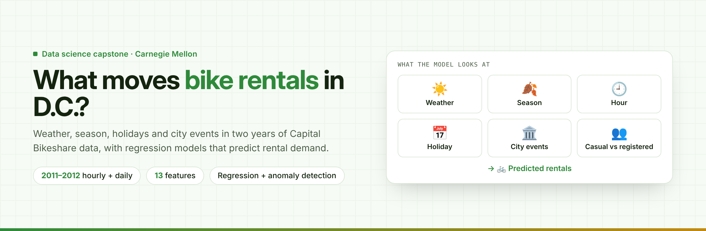

<h1>Bike Sharing Dataset</h1>

Analysis prepared by <b>Jen Kelleman</b>

Data Science Capstone Project

Carnegie Mellon University

February 2025

<h2>Background</h2>

Bike sharing systems have become very popular in many cities, allowing people to easily rent a bike from one location and return it at another. These systems are praised for their benefits in reducing traffic, improving the environment, and promoting health. Additionally, they collect a lot of user data, making them valuable for studying city mobility patterns.

What's cool about bike sharing systems is the data they generate. Unlike buses or subways, they record the exact travel duration and positions. This makes them like a virtual sensor network for city mobility. By monitoring this data, we can detect important events in the city. 

My project focuses on a bike sharing system in Washington, D.C., with records of bike trips in two-hour intervals over a two-year period (2011-2012). The data includes details about each interval, such as weather conditions, the day of the week, temperature, humidity, and windspeed. The main goal is to analyze how the number of bike users has changed over time and how environmental factors influence bike usage.
 

<h2>Research questions</h2>
Based on my research goals, I'm interested in exploring research questions:

<b>1. Environmental and seasonal factors</b>
<li>How do environmental and seasonal factors influence the hourly and daily bike rental counts?
<li>Can we predict the number of bike rentals based on weather conditions, holidays, and other temporal factors?</li>
<li>Is there a correlation between major cultural events in Washington, D.C., and the number of bike rentals?</li>
<li>What patterns can be observed in the bike rental data across different times of the day, days of the week, and months of the year?</li>

<b>2. Bike-rental status</b>
<li>How do casual and registered users differ in their bike rental behaviors?</li>

These questions aim to analyze and predict bike rental trends, considering various influencing factors.

	
<h2>Associated tasks</h2>
<b>1. Regression:</b>

Predication of bike rental count hourly or daily based on the environmental and seasonal settings.

	
<b>2. Event and Anomaly Detection:</b>

<b>**HYPOTHESIS TO BE TESTED:</b> Count of rented bikes are potentially correlated to <b>major cultural events in the town,</b> which are easily verifiable with search engines. For example, the query "National Cherry Blossom Festival in DC" returns search engine results for "March 26-April 10". Here is a valuable reference for highlighting the top 100 most important dates:

                   <li><b>For 2011:</b> https://www.bizbash.com/bizbash-lists/media-gallery/13478255/washingtons-top-100-events-of-2011</li>
                  <li><b>For 2012:</b> https://www.bizbash.com/bizbash-lists/top-100-events/top-list/13230517/washingtons-top-100-events-2012</li>

                  
Therefore the data can be used for validation of event or anomaly detection algorithms as well.

<h2>Dataset characteristics</h2>

The dataset contains the hourly and daily count of rental bikes from the Capital bikeshare system in Washington, DC, covering the years 2011 and 2012. It includes corresponding weather and seasonal information, making it a rich source for analyzing bike rental patterns and their correlation with various factors.

The dataset is multivariate and includes 13 features such as:

<li><b>Date:</b> The date of the observation. </li>
<li><b>Year:</b> Encoded as 0 for 2011 and 1 for 2012. Year (0: 2011, 1:2012).</li>
<li><b>Month:</b> Categorical values from 1 to 12. Month (1 to 12).</li>
<li><b>Hour:</b> Categorical values from 0 to 23. Hour (0 to 23).</li>
<li><b>Holiday:</b> Binary value indicating whether the day is a holiday (extracted from Holiday Schedule).</li>
<li><b>Work day:</b> Categorical values representing the day of the week. If day is neither weekend nor holiday is 1, otherwise is 0.</li>
<li><b>Work Day:</b> Binary value indicating whether the day is a working day.</li>
<li><b>Weather:</b> Categorical values representing different weather conditions.</li>
      <li><b>weathersit:</b>extracted from Freemeteo)</li>
     <li><b>1:</b> Clear, Few clouds, Partly cloudy, Partly cloudy</li>
      <li><b>2:</b> Mist + Cloudy, Mist + Broken clouds, Mist + Few clouds, Mist</li>
      <li><b>3:</b> Light Snow, Light Rain + Thunderstorm + Scattered clouds, Light Rain + Scattered clouds</li>
      <li><b>4:</b> Heavy Rain + Ice Pallets + Thunderstorm + Mist, Snow + Fog</li>
<li><b>Temperature:</b> Normalized temperature in Celsius.</li>
<li><b>Feels Like:</b> Normalized feeling temperature in Celsius.</li>
<li><b>Humidity:</b> Normalized humidity. The values are divided to 100 (max)</li>
<li><b>Windspeed:</b> Normalized wind speed. The values are divided to 67 (max)</li>
<li><b>Casual:</b> The count of casual users in a particular hour.</li>
<li><b>Registered:</b> The count of registered users in a particular hour.</li>

<h2>Main Conclusions and Takeaways</h2>
Summary of insights into predicting future bikeshare system usage. Knowing these insights can help to optimize bike availability and improve the service efficiency.

<li><b>Time-based:</b> Bike rental usage peaks during commuting hours. Specifically, 7am-9am and 5pm-7pm.
<li><b>Weather-based:</b> Higher temperatures, lower windspeed, and lower humidity all generally correspond to an increase in bike rentals.
<li><b>Seasonality:</b> Bike rental usage peaks during the summer months (May, June, July, September).
<li><b>Potential limitations:</b> No information on the exact location of the bikeshare systems, no user type segmentation (e.g., commuters vs. leisure users), and ambiguities in the data.

For future explorations, I recommend during a peak hours analysis, demand forecasting, and operational adjustments.

<li><b>Peak hours analysis:</b> Conduct a detailed analysis of peak hours to understand the factors driving high demand during these times. Look at commuter patterns, in particular. 
  <li><b>Demand forecasting:</b> Use the hourly data to build predictive models for bike rental demand. 
    <li><b>Operational adjustments:</b> Investigate the operational aspects, such as bike availability and maintenance schedules, to ensure that bikes are available at peak hours.

<h2>Appendum</h2> 
To guide the data analysis, I've created additional columns such as:

<li><b>Count:</b> The count of total rental bikes including both casual and registered in a particular hour.</li>
<li><b>MDY:</b> The month day, year of a particular bike-renting instance.</li>
<li><b>Season:</b> Categorical values representing winter, spring, summer, and fall. Season (1:springer, 2:summer, 3:fall, 4:winter)</li> 
<li><b>Holiday Name:</b> Categorical values representing the US government holiday name. 
<li><b>Day of the Week:</b> Categorical values representing the day of the week. Day of the Week (1: Monday, 2: Tuesday, 3: Wednesday, 4: Thursday, 5: Friday, 6: Saturday, 7: Sunday)</li> 
<li><b>Cultural Event:</b> Categorical values representing certain major cultural events held in DC. (

</li>

<h2>Files</h2>
<li><b>Executive summary:</b> <a href="Final_JKExecutiveSummary.pdf">Final_JKExecutiveSummary.pdf</a></li>
<li><b>Raw data:</b> <a href="raw-data/bikeSharing.csv">raw-data/bikeSharing.csv</a></li>
<li><b>Data cleaning:</b> <a href="clean-data/data_cleaning.R">clean-data/data_cleaning.R</a>, which writes <a href="clean-data/clean_bikeSharing.csv">clean-data/clean_bikeSharing.csv</a></li>
<li><b>Exploratory analysis:</b> <a href="bike-eda_files">bike-eda_files/</a> (linear and PCA EDA reports, PDF)</li>
<li><b>Models:</b> <a href="analysis_files/analysis_HW4_linearmodel.R">linear model</a>, <a href="analysis_files/analysis_HW4_PCAmodel.R">PCA model</a> and <a href="analysis_files/analysis_regressiontest.R">regression tests</a>, with how-tos in <a href="analysis_files">analysis_files/</a></li>
<li><b>RStudio project:</b> <a href="rental-bike-sharing.Rproj">rental-bike-sharing.Rproj</a></li>

